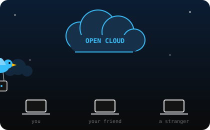

<p align="center">
  
</p>

<h3 align="center">I make things do stuff they're "not supposed to".</h3>
<p align="center">A phone that writes code. A file that blows itself up. A cloud with wings.<br/>Behind each one is a door. Pick one. 👇</p>

<br/>

<details>
<summary><h3>🚪 Door #1: the phone that writes code</h3></summary>
<br/>
<p align="center"><a href="https://phonecando.app"></a></p>

**[PhoneCanDo](https://phonecando.app)**: *AI that can use your phone.*

You tell your phone "fix the bug". It clones the repo, edits the files, runs the tests and pushes. Then it asks if you want chai. No PC, no cloud relay, your keys never leave the phone.

<details>
<summary>🔍 <i>open the toolbox</i></summary>
<br/>

| | |
|---|---|
| 🤖 **A whole crew** | Our own agent, Resident, plus Claude Code, Codex, Gemini CLI and friends, as many at once as your RAM can take |
| 🐧 **Their own Linux** | Each agent gets a real Linux box with apt, git, ssh, tmux and Python. No root needed. |
| 👆 **Hands** | Agents read the screen, tap, type and open apps. Your fingerprint arms it. |
| 🧠 **Offline brains** | Local models through llama.cpp. Your prompts never leave the phone. |
| 📨 **Office gossip** | Agents message each other and wake each other up. |
| ⏰ **Night shift** | Schedule a task and it runs with the screen off, the app closed, while you sleep. |

</details>

**→ [phonecando.app](https://phonecando.app)** · [source](https://github.com/krishna-kush/PhoneCanDo)

</details>

<details>
<summary><h3>🚪 Door #2: the file that blows itself up</h3></summary>
<br/>
<p align="center"><a href="https://tarf.app"></a></p>

**[Tarf](https://tarf.app)**: *licenses that bite back.*

Upload your binary, set the rules, and ship a protected build. It checks it's allowed to run, both before it starts and while it's running. Copied to a machine it doesn't know? 💥 It shreds itself.

<details>
<summary>🔍 <i>open the vault</i></summary>
<br/>

| | |
|---|---|
| 🖥️ **Knows its home** | Locked to the CPU, RAM and MAC of the machines you allow |
| 🔁 **Never stops checking** | Verifies before and during the run, with grace periods for flaky Wi-Fi |
| 🚫 **Kill switch** | Revoke any license, anywhere, instantly |
| 💣 **Self-destruct** | An unauthorized copy deletes itself. Shred or plain delete, your call. |
| 📊 **Snitch mode** | How often it runs, on which machines, and where in the world |

</details>

**→ [tarf.app](https://tarf.app)**

</details>

<details>
<summary><h3>🚪 Door #3: the cloud with wings</h3></summary>
<br/>
<p align="center"><a href="https://cloudbird.app"></a></p>

**[CloudBird](https://cloudbird.app)**: *the world's first Open Cloud.*

Big clouds belong to big companies. This one belongs to everyone. Plug in a machine and you're a provider. Deploy on anyone's machine and you're a customer. The bird carries the servers.

**→ [cloudbird.app](https://cloudbird.app)**

</details>

<details>
<summary><h3>🚪 Door #4: DO NOT OPEN</h3></summary>
<br/>

> You opened it. Of course you did.
>
> That's exactly the kind of person I want to build with. 🪄
> I run **[webjadugar.com](https://webjadugar.com)**. *Jadugar* is Hindi for *magician*.
> If you want to collaborate or make something weird together, I'm the person you're looking for. Open an issue on any repo and say hi.

</details>

<br/>

```text
┌─ PLAYER 1 ───────────────────────────────────────────
│  name ........ Krishna
│  class ....... Jadugar (lvl ∞)
│  guild ....... webjadugar.com
│  weapons ..... Rust · Kotlin · TypeScript · C · curl
│  special ..... makes devices do what they "can't"
│  weakness .... "just one more feature"
│  fuel ........ chai ██████████░░ refilling
└──────────────────────────────────────────────────────
```

### 🏆 Achievements unlocked

- 🐧 **Root? Never heard of her.** Put a full Linux inside an Android app, no root.
- 💣 **Mission Impossible.** Taught a binary to delete itself when stolen.
- 🐦 **Bird is the word.** Gave a cloud wings.
- 📜 **Side quest.** Writing about the meaning of the Ramcharitmanas at [manaskushartha](https://manaskushartha.hikrishna.me).
- 🔒 ~~Sleep 8 hours~~ *(locked, 0.3% complete)*

<p align="center">
  
</p>
